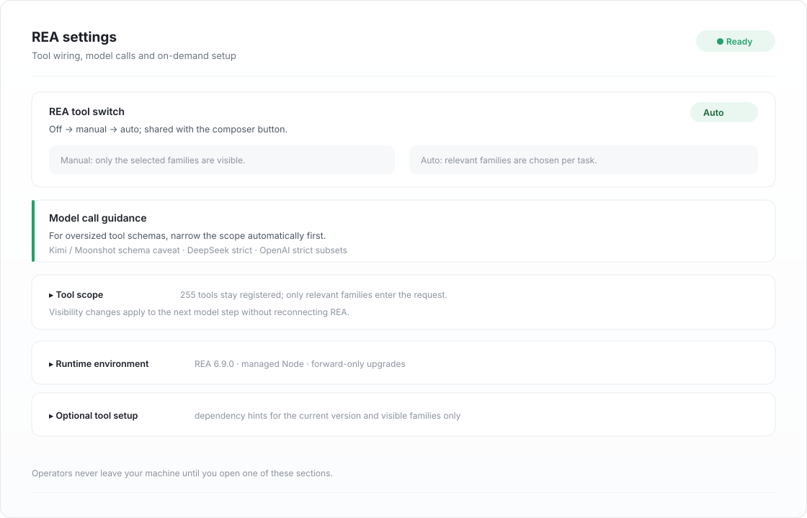

# dsh-reakit

<div align="center">
  
</div>

<div align="center">
  <b>Batteries-included REA integration for DeepSeek Harness</b><br />
  A managed Node and REA runtime, 255 tools with automatic per-task selection,<br />
  seamless off / manual / auto switching, and forward-only runtime upgrades<br /><br />
  <a href="https://www.npmjs.com/package/dsh-reakit"></a>
  <a href="https://www.npmjs.com/package/dsh-reakit"></a>
  <a href="https://github.com/ferrisching/dsh-reakit/stargazers"></a>
  
  
  
  <a href="./LICENSE"></a>
</div>

<div align="center">
  🌏 <a href="./README_zh.md">中文</a> · <b>English</b>
</div>

<div align="center">
  
</div>


`dsh-reakit` puts [REA — Reverse Engineer Anything](https://github.com/morluto/rea) inside [DeepSeek Harness](https://www.deepseek.com/) and owns everything around it: it provisions a pinned Node and REA runtime, registers all 255 tools as `mcp__rea__*`, and can automatically select only the tool families your current task needs. That keeps model requests smaller without reconnecting REA. It also gives you a three-state switch (off / manual / auto), a live status dot and forward-only runtime upgrades. It ships no analysis code — the capability is upstream REA plus the engines you configure.

## 📑 Table of Contents

- [✨ Features](#-features)
- [🎯 Tool scope](#-tool-scope)
- [🚀 Installation](#-installation)
- [⌨ Usage](#-usage)
- [⚙ Settings](#-settings)
- [🧩 How it works](#-how-it-works)
- [🛠 Development](#-development)
- [🔐 Security](#-security)
- [🩺 Troubleshooting](#-troubleshooting)
- [⚠ Known limitations](#-known-limitations)
- [📄 License](#-license)

## ✨ Features

- **Bring your own REA** — if REA is already installed globally, one click detects it and switches the plugin to that copy instead of provisioning a managed runtime; switching back is just as easy
- **Zero path configuration** — the first start provisions pinned Node 24.22.1 and REA 6.9.0 from official sources with a fully locked dependency graph. No global `npm i -g rea-agents`, and your system Node, shell `PATH` and user `npmrc` are never touched
- **Automatic tool selection** — the newest user message is classified by a cheap fixed model, and only the relevant tool families are exposed. Core families stay on by default; mobile and web families open when the task calls for them
- **Full catalogue, scoped on demand** — all 255 tools stay registered, including capabilities that still need an external analyzer. Per-step visibility keeps model requests small without ever uninstalling tools
- **Seamless scope changes** — switching off / manual / auto or changing families applies to the next model step without reconnecting REA, even during a tool call
- **Off until you switch it on** — installing registers the plugin and the switch, but REA stays off and nothing is downloaded; the first activation prepares the runtime
- **One switch, two places** — the composer button and the settings switch drive the same host-accepted state; the UI never keeps an optimistic local copy, and updates propagate across windows
- **Live status dot** — off, ready, running a tool call (pulsing), just finished (one-shot ring), starting, failed, unknown. Sub-second calls still leave a visible ring
- **Call-aware safety** — disabling REA while a tool call is in flight is refused by the UI *and* by the host, so a running analysis is never cut in half
- **On-demand setup instead of a wall of toggles** — one collapsed section, one copyable AI setup prompt that targets this installed instance, and nothing installs itself
- **Honest dependency hints** — a missing analyzer is reported only when a real REA call fails with a reviewed structured code; a later successful call clears it. Optional dependencies are shown only for the current version and visible families
- **Supported upgrades** — an explicit update check reads official metadata, prepares a candidate in isolation, verifies the whole lock, publishes atomically, and upgrades forward only
- **Bilingual UI** — English and Chinese dictionaries through the official locale service; backend diagnostics are English
- **Calm on the wire** — polling is visibility- and focus-aware (0.5 s focused, 2 s unfocused, 6 s hidden) because page plugins get no push channel; no custom network surface is added

## 🎯 Tool scope

Tool definitions travel with every model request, and the full REA 6.9.0 catalogue
is 255 tools (about 353 KB with the compact schema profile). Settings → REA has one shared switch cycling **off → manual → automatic**; the composer
button uses the same state. **Tool scope** holds the family selection.

| Mode | Upside | Downside |
| --- | --- | --- |
| **Manual** (default) | A stable scope and zero extra model calls. | It can carry families you never use, so the request is bigger. |
| **Automatic** | Smaller requests that track the task: core families by default, mobile and web families opened when the task calls for them. | One cheap classification call per new task (fixed `deepseek-flash`). Scope changes apply to the next step without reconnecting REA. |

Automatic mode is deliberately conservative:

- the cache key is the **message content**, so a new task invalidates it and the
  same message is never classified twice;
- a slow or failed classifier **falls back to the keyword rules** — routing never
  fails a model step;
- a manual selection always wins over automatic routing;
- the full catalogue stays registered; only per-step visibility changes, so scope edits do not reconnect REA.

An empty family list means "advertise everything". Optional dependency hints are probed only when the configuration is expanded and are limited to the current REA version and visible families; nothing is installed or removed automatically.

## 🚀 Installation

The plugin is published on npm. Options are ordered by convenience.

### Install inside DSH (recommended)

Open the plugins page → **Add plugin** → enter `dsh-reakit` → install, then enable **REA** in the plugin list.

Or with the DSH CLI:

```bash
dsh plugin --profile desktop add dsh-reakit@0.1.0
```

Replace `--profile` with your own profile (usually `desktop`), then restart DSH. The first start needs network access while the pinned runtime is provisioned; the download is several hundred MB and reused afterwards.

### Install from a tarball

```bash
npm pack dsh-reakit@0.1.0          # or download dsh-reakit-0.1.0.tgz
dsh plugin --profile desktop add ./dsh-reakit-0.1.0.tgz
```

### Install from source

```bash
git clone https://github.com/ferrisching/dsh-reakit.git
cd dsh-reakit
npm ci --ignore-scripts --no-audit --no-fund
npm run check
npm pack --ignore-scripts
dsh plugin --profile desktop add ./dsh-reakit-0.1.0.tgz
```

### Requirements

- Verified on **DSH `0.2.2-rc.2`**; the plugin declares no DSH version range, so it is not refused on other releases — the plugin targets the Cordis 4 bundle API and the official Typert remote surface
- macOS / Linux for the managed runtime path (darwin/linux/win32 are mapped in code; only macOS arm64 is validated on real hardware here)
- Node is not a prerequisite: the managed runtime supplies its own

## ⌨ Usage

The composer shows a compact **REA on / REA off** button in the native tools area, next to whatever else already lives there. It does not depend on other plugins, does not borrow their styles or DOM, and never inserts itself into the context/usage row.

| Action | Effect |
| --- | --- |
| Click the composer button | Toggles the same global switch as Settings, keeping your draft intact |
| Hover the status dot | Shows the full state; while a call runs it lists the running tools |
| Settings → REA → **Input switch** | Hides the composer button without touching REA itself |
| Try to disable during a call | Refused, with an explanation of what is still running |

| Status dot | Meaning |
| --- | --- |
| Grey | REA is off |
| Green | Ready and idle |
| Pulsing green | Running a REA tool call; the label becomes `REA busy` |
| Green ring | A call finished within the last 8 seconds |
| Amber | Starting or switching |
| Red | Connection failed |
| Hollow grey | Status temporarily unavailable |

Turning REA **on** adds the full tool definitions to later model requests; turning it **off** removes them and ends temporary analysis sessions, so export unsaved evidence first. Neither direction rewrites existing conversations.

## ⚙ Settings

**Settings → REA** (also reachable from the plugin detail page):

| Section | What it does |
| --- | --- |
| REA tool switch | Master switch, shared with the composer button, with the call-lock explanation inline |
| Model call guidance | Conditional advice: if a model call fails because the parameter schema exceeds the allowed size, temporarily disable REA and retry. Lists the Kimi / Moonshot schema-size caveat and the JSON Schema subset rules of DeepSeek strict mode and OpenAI strict tool mode |
| Input switch | Show or hide the composer button; stored through official Config Forms, synced to other windows, never restarts REA |
| Runtime version | Collapsed. **Check for updates** reads official npm and Node.js metadata; preparing a candidate requires two confirmations; only one version is kept and there is no rollback button, so going back means re-downloading the previous release |
| Optional tool setup | Collapsed. One copyable AI prompt scoped to this installed instance; nothing is installed by the plugin |

Advanced fields live in the profile configuration. `npmRegistry` accepts an https mirror (no credentials, query or fragment) for the REA package install; integrity still comes from the lockfile SRI, so a mirror never weakens verification. Empty keeps `registry.npmjs.org`. `nodeMirror` does the same for the Node distribution: an https base such as `https://mirror.example.com/nodejs`, whose `SHASUMS256.txt` must agree with the pinned digest before anything is extracted; empty keeps `nodejs.org/dist`.

The panel uses scoped compact typography (13px body, 16px title, 12px code) and never leaks styles to the host page or the composer button.

### Setup failures say what to fix

A failed preparation is classified before it reaches the status line: a **network** problem (DNS, timeout, refused connection, TLS, HTTP 4xx/5xx, proxy), a **full disk** (`ENOSPC`), or a **permission** problem (`EACCES`/`EPERM`/`EROFS`). Each gets one actionable sentence naming the managed root; anything else keeps its original wording so a real bug is never hidden behind a generic message. `npm` output is inspected too, because its exit code alone is usually just `1`.

### Split runtime layout

A fresh install publishes two independent trees under the managed root:

```
runtime/node/<platform>-<arch>-<node>-<sha12>/   Node distribution + ready.json
runtime/engine/rea<version>-<lock12>/           REA install + ready.json
```

Dropping the Node part therefore only costs a re-download, never the REA install. Each part carries its own ready marker; both are verified offline on every start (versions, archive digest, dependency lock, entry digest), and a half-published runtime is rolled back instead of being used. Existing installations from the older combined layout are migrated with a copy-verify-then-switch step, and the legacy generations are only removed after the new layout has started successfully.

### Where Node lives

On a machine with no usable Node the plugin does not download anything by itself. It asks first: **install into the plugin environment** (a private, integrity-checked runtime that never touches your system Node) or **install on your machine** (the plugin names the installers it actually found — Homebrew, nvm, apt, dnf, winget or Chocolatey — with the exact command and a copy button, then re-detects). Anything it cannot verify, including a machine with no installer at all, is reported instead of assumed.

### Shared runtime safety

The runtime directory is shared by every DSH profile by default. Before deleting it the plugin asks the host which other profiles still run REA in managed mode; if any does, deletion is refused with the profile names, so one window can never strand another. Abandoned staging trees from a crashed install are cleaned up automatically before the next attempt, and the detector also covers the Windows global locations (`%APPDATA%\npm`, `%LOCALAPPDATA%\pnpm`, `%ProgramFiles%\nodejs`).

### Bring your own REA

If REA is already installed on this machine, the plugin can drive that copy instead of the managed runtime. Open **Settings → REA → Existing REA installation** and press **Detect an installed REA**: the plugin scans the deterministic global roots it can name without running npm or REA, validates the package name, the `scripts/rea.mjs` entry and the REA `engines.node` contract, and offers only installations that pass. Each candidate is checked against the plugin's managed Node first and the host process Node second, so a REA that needs a newer Node still works, and the panel states which Node will run it. **Choose a Node** then lists every Node the plugin can find — the managed Node first, then your own installations — with its version and whether it satisfies the REA `engines.node` range. Picking an incompatible one shows the required range, its version, and a **one-click upgrade to the plugin-managed Node**; if even the managed Node is too old, the panel points you at *Runtime version → Check for updates*. **Use this Node** writes the manual `nodePath` / `reaEntry` pair, and **Switch back to the managed runtime** clears it again. After adopting your own environment the plugin asks whether to **delete** the downloaded Node to reclaim the space or **keep** it. Only the Node part is removed — the installed REA engine stays, so switching back costs a Node download, not a full reinstall. The decision is remembered until the next adoption.

Adoption is a configuration change, not a silent swap: the host compares the current pair before writing, refuses a path that is not the package entry, and reports an incompatible Node as a reason instead of marking the install ready. Nothing is downloaded and nothing is uninstalled either way.

## 🧩 How it works

**Host side** (`lib/`)

1. `lib/index.js` declares the config schema, resolves the managed runtime and registers the `reaComponents/*` Typert endpoints
2. `lib/bootstrap.js` provisions the pinned runtime: staging directory, archive digest check, `npm ci --ignore-scripts --include=optional`, ready marker, atomic publish
3. `lib/runtime-versions.js` implements the update check and candidate preparation; `lib/runtime-manager.js` implements forward-only switching and quiescence checks
4. `lib/optional-tools.js` wraps the official `tools/execute` event to count only locked REA tool calls, and observes `tools/result` for reviewed dependency codes

**Client side** (`client/client.js`)

- Registers three slots: `conversation.input.left` (button), `settings.section` (panel) and `plugins.detail.section` (detail panel)
- Renders with the host's own React module; no bundler and no runtime dependencies
- Reads status over unary RPC; the cadence adapts to focus and visibility because page plugins receive no push channel

## 🛠 Development

```bash
npm ci --ignore-scripts --no-audit --no-fund
npm run check        # 182 cases: host, client render, runtime, components
npm run pack:check
npm pack --ignore-scripts
```

```
.
├── lib/                     Host side (plain ESM, no build step)
│   ├── index.js             Plugin entry, config schema, Typert service registration
│   ├── bootstrap.js         Managed runtime provisioning and offline re-verification
│   ├── runtime-versions.js  Update check, candidate staging, lock verification
│   ├── runtime-manager.js   Forward-only switch, session quiescence
│   ├── components*.js       Optional analyzer catalogue and install plans
│   └── optional-tools.js    Activity tracking and dependency hints
├── client/client.js         Composer button, status dot, settings panel, i18n
├── assets/engine/           Pinned engine manifest and dependency lock
├── docs/ACCEPTANCE.md       Recorded verification evidence
└── test/                    182 tests, no network and no real installs
```

Real-engine checks are explicit and never part of `npm test`:

```bash
node scripts/zero-config-acceptance.mjs /absolute/new-evidence-directory
node scripts/acceptance.mjs /absolute/manual-config.json /absolute/owned-app.asar /absolute/new-evidence-directory
```

## 🔐 Security

This is not a sandbox. The REA child process runs with your user privileges, and the full tool set includes launching programs, writing files, device access and network observation — every operation still needs your authorisation. Content returned by tools is untrusted data, not instructions. Tool results enter the agent and are then subject to your model provider's data policy.

- Downloads are verified against pinned SHA-256 digests and npm SRI; lifecycle scripts stay disabled
- Switching versions requires two explicit confirmations and refuses to run while analysis work is active
- Analysis targets, devices, browsers and commercial licences are never started or handled automatically
- The plugin is MIT; REA and its tools keep their own licences ([REA MIT](https://github.com/morluto/rea/blob/main/LICENSE), [third-party notices](https://github.com/morluto/rea/blob/main/THIRD_PARTY_NOTICES.md))

## 🩺 Troubleshooting

| Symptom | Likely cause | What to do |
| --- | --- | --- |
| Dot stays grey, no tools | REA is switched off | Enable it from the composer button or Settings → REA |
| Dot red, "connection failed" | Runtime missing or tampered | Open Settings → REA, read the error, then retry setup |
| First start seems stuck | Runtime download in progress (hundreds of MB) | Wait; the panel shows the phase and any error |
| Model call fails with a schema-size error | Tool definitions too large for the provider | Temporarily disable REA, retry, re-enable when needed |
| A capability says a provider is missing | Optional analyzer not configured | Open Optional tool setup and follow the copied prompt |

A standalone `doctor` success only proves the installation preflight — not the MCP connection, the analyzers or a target application.

## ⚠ Known limitations

- The status dot is polled, not pushed: page plugins get no event channel and cannot extend the host allowlist. A call shorter than one interval can still be missed, which the 8-second ring covers
- Only macOS arm64 has been validated end to end; darwin/linux/win32 are mapped in code but not proven on real hardware
- Windows path handling for the managed runtime is untested
- The runtime directory name stays `~/.dsh/dsh-reakit` under `DSH_HOME`; moving it manually breaks the ready marker and re-provisions
- Some REA capabilities need licences or platform tooling that this plugin deliberately does not automate

## 📄 License

MIT, see [LICENSE](./LICENSE). REA is MIT and maintained separately; report REA bugs upstream and plugin bugs to [this repository's issues](https://github.com/ferrisching/dsh-reakit/issues).
