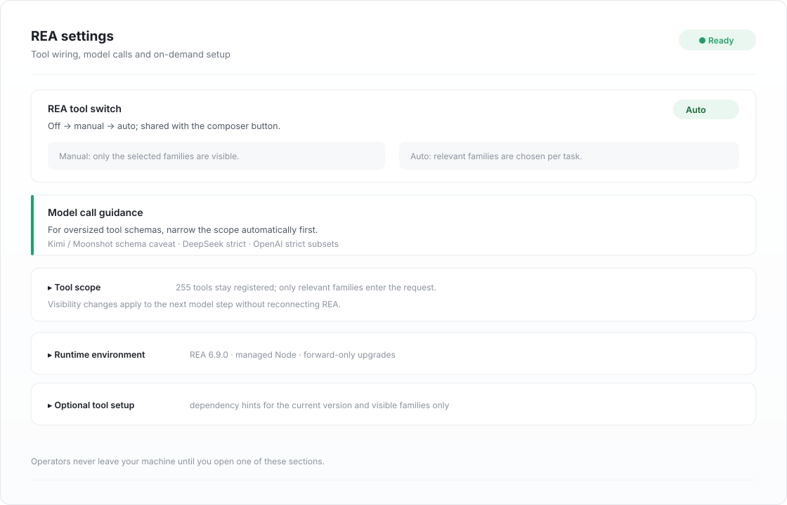

# dsh-reakit

<div align="center">
  
</div>

<div align="center">
  <b>为 DeepSeek Harness 准备的 REA 一体化插件</b><br />
  自托管 Node 与 REA 运行时、覆盖全部 229 项工具的单一开关、输入框运行状态点、<br />
  按需配置可选分析器，以及可回退的运行时版本升级<br /><br />
  <a href="https://www.npmjs.com/package/dsh-reakit"></a>
  <a href="https://www.npmjs.com/package/dsh-reakit"></a>
  <a href="https://github.com/ferrisching/dsh-reakit/stargazers"></a>
  
  
  
  <a href="./LICENSE"></a>
</div>

<div align="center">
  🌏 <b>中文</b> · <a href="./README.md">English</a>
</div>

<div align="center">
  
</div>


`dsh-reakit` 把 [REA — Reverse Engineer Anything](https://github.com/morluto/rea) 接进 [DeepSeek Harness](https://www.deepseek.com/)，并接管它周边的一切：自动准备固定版本的 Node 与 REA 运行时，把完整工具目录注册为 `mcp__rea__*`，同时提供单一开关、实时状态点和受支持的升级路径。插件本身不含分析代码——能力来自上游 REA 与你配置的引擎。

## 📑 目录

- [✨ 功能一览](#-功能一览)
- [🚀 安装](#-安装)
- [⌨ 使用](#-使用)
- [⚙ 设置](#-设置)
- [🧩 工作原理](#-工作原理)
- [🛠 开发](#-开发)
- [🔐 安全](#-安全)
- [🩺 排查](#-排查)
- [⚠ 已知限制](#-已知限制)
- [📄 许可](#-许可)

## ✨ 功能一览

- **接入已有 REA** —— 本机已经全局装过 REA 时，一键检测并让插件改用那份安装，而不是再准备托管运行时；切回托管同样一键完成
- **零路径配置** —— 首次启动从官方来源准备固定 Node 24.22.1 与 REA 6.8.0，依赖图完整锁定。无需全局 `npm i -g rea-agents`，且不改动系统 Node、shell `PATH` 与用户 `npmrc`
- **完整目录，从不裁剪** —— 229 项 REA 工具全部注册为 `mcp__rea__*`；尚未配置外部分析器的工具同样保留，不会被隐藏
- **一个开关，两处入口** —— 输入框按钮与设置页开关共用宿主已接受的状态；界面不维护乐观副本，跨窗口自动同步
- **实时状态点** —— 关闭、就绪、正在调用（脉冲）、刚刚完成（一次性描边环）、启动中、失败、未知；毫秒级调用也会留下可见痕迹
- **调用中禁止关闭** —— 有工具调用在执行时，界面**与宿主**都会拒绝关闭，正在跑的分析不会被切成两半
- **按需配置，而非堆砌开关** —— 一个默认折叠的区域、一份针对当前已安装实例的 AI 配置指令，插件自身不安装任何东西
- **诚实的依赖提示** —— 只有真实 REA 调用返回已审阅的结构化错误码时才提示缺少分析器；同一工具调用成功后提示自动清除
- **受支持的升级** —— 显式检查更新、隔离准备候选、完整校验锁文件、原子发布，并保留上一代用于回退
- **界面中英双语** —— 通过官方 locale 服务提供中英词典；后端诊断信息使用英文
- **对宿主保持克制** —— 按焦点与可见性分级轮询（聚焦 0.5 秒、失焦 2 秒、隐藏 6 秒），因为页面插件没有推送通道；不新增任何自有网络接口

## 🚀 安装

插件已发布到 npm，按便利程度列出几种方式。

### 在 DSH 内安装（推荐）

打开插件页 → **添加插件** → 输入 `dsh-reakit` → 安装，然后在插件列表中启用 **REA**。

或使用 DSH 命令行：

```bash
dsh plugin --profile desktop add dsh-reakit@0.1.0
```

把 `--profile` 换成自己的 profile（桌面端通常是 `desktop`），随后重启 DSH。首次启动需要联网准备固定运行时，体积数百 MB，之后直接复用。

### 从 tarball 安装

```bash
npm pack dsh-reakit@0.1.0          # 或直接下载 dsh-reakit-0.1.0.tgz
dsh plugin --profile desktop add ./dsh-reakit-0.1.0.tgz
```

### 从源码安装

```bash
git clone https://github.com/ferrisching/dsh-reakit.git
cd dsh-reakit
npm ci --ignore-scripts --no-audit --no-fund
npm run check
npm pack --ignore-scripts
dsh plugin --profile desktop add ./dsh-reakit-0.1.0.tgz
```

### 环境要求

- 已在 **DSH `0.2.2-rc.1`** 上验证；插件依赖 Cordis 4 的 bundle API 与官方 Typert remote 接口
- 托管运行时按 darwin / linux / win32 映射，但只有 macOS arm64 做过真机验收
- 不要求本机安装 Node：托管运行时自带

## ⌨ 使用

输入框底部原生工具区会显示紧凑的 **REA 开 / REA 关** 按钮，排列在既有控件之后。它不依赖其他插件、不借用它们的样式或 DOM，也不会插进上下文/用量信息行。

| 操作 | 效果 |
| --- | --- |
| 点击输入框按钮 | 切换与设置页相同的全局开关，输入草稿不受影响 |
| 悬停状态点 | 显示完整状态；调用进行中会列出正在运行的工具名 |
| 设置 → REA → 输入框快捷开关 | 隐藏按钮，但不影响 REA 本身 |
| 调用进行中尝试关闭 | 被拒绝，并说明仍在执行的内容 |

| 状态点 | 含义 |
| --- | --- |
| 灰色 | REA 已关闭 |
| 绿色常亮 | 已就绪，空闲 |
| 绿色脉冲 | 正在执行 REA 工具调用，文字显示 `REA 用` |
| 绿色描边环 | 最近 8 秒内完成过一次调用 |
| 琥珀色 | 启动或切换中 |
| 红色 | 连接失败 |
| 灰色空心 | 状态暂不可用 |

开启 REA 会向后续模型请求加入完整工具定义；关闭则移除这些定义并结束临时分析会话，请先导出未保存的证据。两个方向都不会回溯改写既有对话。

## ⚙ 设置

**设置 → REA**（也可从插件详情页进入）：

| 区域 | 作用 |
| --- | --- |
| REA 工具总开关 | 与输入框按钮共用的总开关，并在需要时说明为何不能关闭 |
| 模型调用提示 | 条件建议：当模型因参数 Schema 超过允许大小而调用失败时，可临时关闭 REA 后重试。同时列出 Kimi / Moonshot 的 Schema 尺寸注意事项，以及 DeepSeek strict 模式与 OpenAI strict 工具模式的 JSON Schema 子集规则 |
| 输入框快捷开关 | 显示或隐藏输入框按钮；通过官方 Config Forms 保存并同步到其他窗口，不重启 REA |
| 运行时版本 | 默认折叠。**检查更新** 读取官方 npm 与 Node.js 元数据；准备候选需要两次确认；磁盘只保留一个版本且不提供回退，需要回到旧版只能重新安装 |
| 可选工具配置 | 默认折叠。一份针对当前已安装实例的可复制 AI 指令；插件自身不安装任何组件 |

高级字段在 profile 配置中。`npmRegistry` 可填安装 REA 依赖时使用的 https 镜像（不允许内嵌凭据、查询参数或片段）；完整性仍由锁文件的 SRI 保证，换镜像不降低校验强度。留空则使用 `registry.npmjs.org`。`nodeMirror` 同理作用于 Node 发行版：填 https 基地址（如 `https://mirror.example.com/nodejs`），其 `SHASUMS256.txt` 必须与源码里固定的摘要一致才会解压；留空使用 `nodejs.org/dist`。

面板使用局部紧凑排版（正文 13px、标题 16px、代码 12px），样式不会外溢到宿主页面或输入框按钮。

### 失败时告诉你该修什么

准备失败会先归类再写进状态行：**网络**（DNS、超时、连接被拒、TLS、HTTP 4xx/5xx、代理）、**磁盘满**（`ENOSPC`）、**权限不足**（`EACCES`/`EPERM`/`EROFS`）。三类各给一句可执行的说明并点明托管目录；其余错误保留原始文案，避免真实缺陷被通用话术掩盖。`npm` 的 stderr 也会被检查，因为它的退出码通常只是 `1`。


全新安装会在托管根目录下发布两棵互不依赖的树：

```
runtime/node/<平台>-<架构>-<版本>-<摘要12>/   Node 发行版 + ready.json
runtime/engine/rea<版本>-<锁摘要12>/          REA 安装 + ready.json
```

因此删掉 Node 只需要重新下载它，不会影响已装的 REA。两部分各有自己的 ready 标记，每次启动都会离线校验（版本、归档摘要、依赖锁、入口摘要）；只发布了一半的运行时会被回滚而不是继续使用。旧的合并布局通过“复制—校验—切换”的方式迁移，旧 generation 只有在新布局成功启动后才删除。


机器上没有可用 Node 时，插件不会自己下载，而是先问：**装到插件环境**（私有、带完整性校验，不碰系统 Node），还是**装到本机**（插件只列出它真正找到的安装方式——Homebrew、nvm、apt、dnf、winget、Chocolatey——给出确切命令和复制按钮，装好后回来重新检测）。无法确认的情况（包括一个安装器都没有）都会如实报告，不替用户猜。

### 共享运行时保护

运行时目录默认由所有 DSH profile 共享。删除前插件会询问宿主还有哪些 profile 处于托管模式；只要仍有，就拒绝删除并列出这些 profile，避免一个窗口把另一个窗口的运行时删掉。上次安装崩溃留下的 staging 目录会在下次准备前自动清理；检测范围也覆盖 Windows 的全局位置（`%APPDATA%\npm`、`%LOCALAPPDATA%\pnpm`、`%ProgramFiles%\nodejs`）。

### 接入已有 REA

本机已经装过 REA 时，插件可以直接使用那份安装，而不必再准备托管运行时。打开 **设置 → REA → 已有 REA 安装**，点击 **检测已安装的 REA**：插件只扫描能确定命名的全局目录，不运行 npm、也不运行 REA，逐项校验包名、`scripts/rea.mjs` 入口以及 REA 的 `engines.node` 契约，只列出通过的安装。每个候选先按插件自带的托管 Node 校验，再退回宿主进程 Node，因此需要更新 Node 的 REA 也能接入；面板会写明将用哪个 Node 运行。点击 **选择 Node 并接入** 会列出插件能找到的全部 Node：托管 Node 在前，自有 Node 在后，并标明版本以及是否满足该 REA 的 `engines.node`。选到不满足的一项时，面板会显示所需范围与当前版本，并给出 **一键升级到插件托管 Node**；若连托管 Node 也不满足，则提示先去 *运行时版本 → 检查更新*。点击 **用这个 Node 接入** 写入 `nodePath` / `reaEntry`，**切回托管运行时** 则清空并回到托管模式。接入自有环境后，插件会询问是 **删除** 已下载的 Node 以释放空间，还是 **保留**。只删 Node 部分——已安装的 REA 引擎保留，切回只需补下 Node，不必整套重装。该选择会被记住，直到下次接入。

接入是一次明确的配置变更，不是静默替换：宿主写入前会比对当前路径对，拒绝非包入口的路径，并把 Node 不兼容作为原因返回而不是标记为就绪。两个方向都不下载新内容、也不卸载任何东西。

## 🧩 工作原理

**宿主侧**（`lib/`）

1. `lib/index.js` 声明配置结构、解析托管运行时并注册 `reaComponents/*` Typert 端点
2. `lib/bootstrap.js` 负责准备运行时：staging 目录、归档摘要校验、`npm ci --ignore-scripts --include=optional`、ready 标记、原子发布
3. `lib/runtime-versions.js` 实现检查更新与候选准备；`lib/runtime-manager.js` 实现切换、会话静默检查与回退
4. `lib/optional-tools.js` 包装官方 `tools/execute` 事件，只统计锁定 REA 目录内的调用，并观察 `tools/result` 以便给出已审阅的依赖提示

**客户端**（`client/client.js`）

- 注册三个扩展点：`conversation.input.left`（按钮）、`settings.section`（设置面板）、`plugins.detail.section`（详情面板）
- 复用宿主自带的 React 模块渲染，无打包步骤、无运行时依赖
- 通过一元 RPC 读取状态；因为页面插件没有推送通道，轮询频率随焦点与可见性调整

## 🛠 开发

```bash
npm ci --ignore-scripts --no-audit --no-fund
npm run check        # 182 项：宿主、客户端渲染、运行时、组件
npm run pack:check
npm pack --ignore-scripts
```

```
.
├── lib/                     宿主侧（纯 ESM，无构建步骤）
│   ├── index.js             插件入口、配置结构、Typert 服务注册
│   ├── bootstrap.js         托管运行时准备与离线复核
│   ├── runtime-versions.js  检查更新、候选 staging、锁校验
│   ├── runtime-manager.js   切换、回退、会话静默检查
│   ├── components*.js       可选分析器目录与安装计划
│   └── optional-tools.js    调用活动统计与依赖提示
├── client/client.js         输入框按钮、状态点、设置面板、双语文案
├── assets/engine/           固定引擎清单与依赖锁
├── docs/ACCEPTANCE.md       已记录的验收证据
└── test/                    182 项测试，不联网、不真实安装
```

真实引擎检查是显式脚本，不进入 `npm test`：

```bash
node scripts/zero-config-acceptance.mjs /absolute/new-evidence-directory
node scripts/acceptance.mjs /absolute/manual-config.json /absolute/owned-app.asar /absolute/new-evidence-directory
```

## 🔐 安全

这不是沙箱。REA 子进程以你的用户权限运行，完整工具集包括启动程序、写文件、设备访问与网络观测——每一次实际操作用仍需作者授权。工具返回的内容是不可信数据，不是指令。工具结果进入 agent 后受所选模型服务的数据政策约束。

- 下载内容按固定 SHA-256 与 npm SRI 校验；依赖生命周期脚本保持禁用
- 切换运行时版本需要两次明确确认，且分析工作活动期间拒绝执行
- 不自动启动分析目标、设备、浏览器，也不代办商业许可证
- 本插件 MIT；REA 及其工具保留各自许可（[REA MIT](https://github.com/morluto/rea/blob/main/LICENSE)、[第三方声明](https://github.com/morluto/rea/blob/main/THIRD_PARTY_NOTICES.md)）

## 🩺 排查

| 现象 | 可能原因 | 处理方式 |
| --- | --- | --- |
| 状态点常灰、没有工具 | REA 处于关闭状态 | 通过输入框按钮或设置页开启 |
| 状态点变红、提示连接失败 | 运行时缺失或被篡改 | 打开设置 → REA 查看错误，再重试准备 |
| 首次启动卡住 | 正在下载运行时（数百 MB） | 等待；面板会显示阶段与错误 |
| 模型调用报 Schema 尺寸错误 | 工具定义超出提供方限制 | 临时关闭 REA 重试，需要时再开启 |
| 某能力提示缺少 provider | 可选分析器未配置 | 展开“可选工具配置”，按复制的指令处理 |

单独运行 `doctor` 成功只能证明安装预检通过，不代表 MCP 连接、分析器或目标应用就绪。

## ⚠ 已知限制

- 状态点是轮询而非推送：页面插件拿不到事件通道，也无法扩展宿主白名单。短于一个轮询间隔的调用仍可能被漏采，由 8 秒描边环兜底
- 只有 macOS arm64 做过端到端验收；darwin / linux / win32 在代码中已映射，但未在真机验证
- 托管运行时在 Windows 上的路径处理尚未测试
- 运行时目录固定为 `DSH_HOME` 下的 `~/.dsh/dsh-reakit`；手工移动会导致 ready 标记失配并重新准备
- 部分 REA 能力需要许可证或平台工具，本插件有意不自动化这些环节

## 📄 许可

MIT，见 [LICENSE](./LICENSE)。REA 自身为 MIT 且独立维护；REA 的问题请报给上游，插件的问题请提到[本仓库的 issues](https://github.com/ferrisching/dsh-reakit/issues)。
